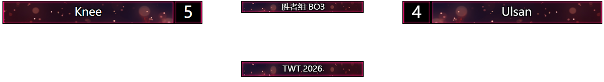

[使用说明.md](https://github.com/user-attachments/files/33599070/default.md)
# 直播计分板 · 通用版 使用说明

一款为 **格斗游戏直播**打造的超轻量计分板。我将YMSB计分板汉化后整合为一个程序，**单文件程序仅 190 KB**，双击即用；支持**导入设计压缩包**自由切换各游戏画面样式，通过 OBS / B站直播姬的「浏览器来源」叠加到直播画面上。

---

## 一、快速开始（3 步开播）

1. **打开软件**：双击 `直播计分板.exe`。
2. **选择画面样式**：在「设计」页选一个设计（软件已内置清爽版，也可导入各游戏官方风格包，见第三节）。
3. **叠加到直播**：OBS / 直播姬添加「浏览器」来源，地址填：
   ```
   http://localhost:53217/overlay
   ```
   宽 **1920**、高 **1080**，背景自动透明。

> ⚠ 软件开着画面才会显示。
> 📌 端口以软件状态栏显示的实际端口为准（默认 53217，被占用时会自动顺延到 53218~53226 并记住）。

---

## 二、界面功能

### 比分页
- 双方 **＋ / −** 调整比分；
- **败者标记**：勾选后画面中该方置灰；
- **交换左右**：一键互换双方全部信息（名称/比分/标志图）；
- **重置比分**：比分、败者标记归零（名称保留）。

### 信息页
- 赛事名称、阶段 / 轮次、赛制（BO1/BO3/BO5/BO7 或自定义文字）；
- 每个输入框下方都有说明，标明它在画面上的显示位置；
- **留空会自动隐藏**：赛事名称为空 → 画面上对应区域不显示；
  阶段与赛制都为空 → 中央大框也不显示（避免出现空白底板）。

### 队伍页
- 名称、标签、**队伍标志图**（PNG/JPG/BMP/GIF，自动压缩）；
- 每个输入框下方都有说明：
  - 名称 → 显示在画面队名牌（大字）上
  - 标签 → 显示在选手条区域（如战队缩写），留空不显示
  - 队伍标志 → 显示在画面角落，留空不显示

### 设计页（核心功能）
- **导入设计压缩包**：选择 `.zip` 直接导入（YMSB 4.5 风格的设计包），导入后自动切换，画面即时生效；
- 已安装设计列表：显示名称与皮肤数量，可 **应用 / 删除**；
- **皮肤选择**：每个设计自带多套皮肤（如铁拳8 有 8 套），点「皮肤 01~09」即时切换，OBS 画面无需刷新；
- 「打开设计文件夹」可直接查看/管理已导入的设计文件。

### 快捷键页
- 6 个动作可自定义**全局快捷键**（切到 OBS、游戏里也能用）；
- 设置方法：**直接用鼠标点一下快捷键输入框，然后按下新的按键/组合键即可**（点击即录）；
- 点「清除」可停用某个动作；页面左下角的 **「↺ 恢复默认快捷键」** 按钮可一键还原；
- **支持组合键和单键两种方式**：

| 方式 | 说明 | 建议 |
| --- | --- | --- |
| 单键 | 直接按单个按键（如 `F1`、`小键盘+`） | 一个键一个动作，直播打分手速快 |
| 组合键 | 如 `Ctrl+Alt+E` | 不占用日常按键，适合键盘上想同时打字的场景 |

#### 默认快捷键（v6 起）

| 动作 | 默认快捷键 |
| --- | --- |
| 左方比分 +1 / −1 | `F1` / `F2` |
| 右方比分 +1 / −1 | `F3` / `F4` |
| 交换左右双方 | `F5` |
| 重置比分 | `F6` |

> **为什么改成 F1-F6？**
> 因为本软件用的是 Windows **全局快捷键**（`RegisterHotKey` API）——这是操作系统级别的注册，只要软件开着，被注册的键就会被软件截获，其他程序（包括记事本、微信、游戏聊天框）都收不到。
> 早期默认用的是 `Q / W / [ / ] / \`，打字时按这些键会误触发计分。F1~F6 在 Windows 上默认没被任何常用软件占用，且不与游戏操作键冲突，是最省心的默认选择。
> 同类软件（YMSB、OBS 快捷键、直播伴侣等）也都是这种机制，都遵循「避开字母/符号键、优先功能键或小键盘」的惯例。

#### 想改回单键怎么办？
- 点输入框 → 按你想要的键即可；
- **推荐用数字小键盘**（`小键盘 0~9`、`+` `−` `×` `÷` `.`）——需要开启 **NumLock**，日常打字几乎用不到小键盘，冲突概率最低；
- 或者用 `F7`~`F12`、`PrtSc`、`ScrollLock` 等冷门键；
- 想彻底不占用键盘，用**组合键**（`Ctrl+Alt+1` 之类）最保险。

> ⚠ 若某个键被其他软件占用，界面会提示「被占用」，重新点输入框换一个即可。

---

### 手机遥控（手机当导播台）
内置一个**中文手机遥控页面**，用手机浏览器就能改比分，界面与电脑软件同一套设计（深色风格、大按钮、适合单手操作）。

**怎么用**
1. 软件切到「**手机遥控**」页 → 点「**允许手机访问（需授权一次）**」→ 系统弹出授权窗口点「**是**」（只需设置一次）；
2. 手机连接**与电脑相同的 Wi-Fi**；
3. **用手机相机扫一扫页面上显示的二维码**即可打开遥控页（也可点「复制手机地址」发给自己，或在手机浏览器里手动输入）；
4. 打开后即可直接操作，**改动自动保存并实时同步**到电脑软件与 OBS / 直播姬 画面（约 0.3 秒内）。

> 二维码在授权成功后自动显示（含手机地址）；在电脑浏览器里打开 `http://localhost:端口/qr.png` 也能看到放大版二维码。

**页面能做什么**
| 区域 | 功能 |
| --- | --- |
| 扫码连接 | 显示手机遥控页二维码（手机相机扫一扫即可打开），旁边有手机地址与提示 |
| 蓝方 / 红方卡片 | 改队名、标签，`−` `＋` 调比分（大字显示），勾选败者标记 |
| 赛事信息 | 赛事名称、阶段 / 轮次、赛制（如 BO5） |
| 底部按钮 | **⇄ 交换左右**（含名称/比分/标志图整体互换）、**重置比分**、**↻ 刷新**（读取最新数据） |

- 「本机预览」按钮可在电脑浏览器里查看手机页面效果；
- 页面右上角显示连接状态（已连接 / 未连接）；
- 手机地址固定不变（软件会记住端口），可存成手机书签。
- 若授权窗口失败 / 被取消，可右键软件 →「以管理员身份运行」再点一次。

> 说明：手机页面改的数据 = 本软件的数据，三者（手机 / 电脑软件 / 直播画面）始终保持同步。

---

## 三、OBS / B站直播姬 添加素材（图文）

### 3.1 OBS Studio 添加「浏览器」来源

**第 1 步：在「来源」面板点 ＋，选「浏览器」**


- 打开 OBS → 底部「来源」面板 → 点 **＋** 号；
- 弹出菜单里选 **浏览器 (Browser)**；
- 若弹出「新建/重命名」对话框，随便起个名（如「直播计分板」），点确定。

**第 2 步：填 URL 和宽高**


| 字段 | 填什么 |
| --- | --- |
| **URL** | `http://localhost:53217/overlay`（端口以软件状态栏为准） |
| **宽度 / 高度** | `1920 × 1080`（详见 3.3 分辨率对照） |
| **FPS** | `30` 即可 |
| **关闭当不活跃时** | 勾选（省资源） |
| **控件可见（硬件加速）** | 勾选 |
| **自定义 CSS** | 留空 |

- 点「确定」→ OBS 预览里就能看到计分板浮在游戏上；
- 若画面空白：在「来源」列表里选中它 → 右键「刷新」。

### 3.2 B站直播姬 添加「浏览器」素材

**第 1 步：右侧「当前素材」面板 → 点「＋ 添加素材」**


**第 2 步：素材弹窗里选「浏览器 / 网页」→ 填 URL 与宽高**


| 字段 | 填什么 |
| --- | --- |
| **URL** | `http://localhost:53217/overlay` |
| **宽度 / 高度** | `1920 × 1080` |

- 点「确定」→ 直播姬预览区出现计分板 → 拖到画面顶部即可。

### 3.3 素材宽高：不同显示器怎么选


**核心原则：填「你的直播输出分辨率」，不是显示器的物理分辨率。**

| 场景 | 显示器 | OBS 输出（设置→视频→输出(缩放)分辨率） | 浏览器素材宽高 |
| --- | --- | --- | --- |
| 主流推荐 | 1080P | 1920×1080 | **1920 × 1080** |
| 2K 电竞 | 1440P | 1920×1080（大多数平台推荐） | **1920 × 1080** |
| 2K 电竞 | 1440P | 2560×1440（高码率推流） | 2560 × 1440 |
| 4K 直播 | 4K | 3840×2160 | 3840 × 2160（FPS 60、缩放系数 2） |
| 带鱼屏 | 3440×1440 | 一般裁成 1920×1080 | **1920 × 1080** |
| 竖屏手游 | 手机 | 1080×1920 | 1080 × 1920 |

> **一句话记法**：打开 OBS → 设置 → 视频 → 看「输出(缩放)分辨率」是多少，浏览器素材宽高就填多少，两者永远一致最稳。
>
> **常见误区**：把自己显示器的物理分辨率（比如 4K 屏）当输出分辨率填给 OBS，会导致画面被压扁或拉伸——观众看到的其实是 OBS 那个"输出分辨率"，不是你的显示器分辨率。
>
> **不知道填什么？** 就 `1920 × 1080`——这是 99% 直播平台（B站、斗鱼、虎牙、抖音、视频号）的默认推荐比例。

### 3.4 素材太大 / 太小怎么办


- **不要改浏览器素材的宽高**（那个是"渲染分辨率"，改了会变糊）；
- **改 OBS / 直播姬 里的"变换"**：
  - OBS：选中素材 → 按住 `Shift` 拖角点缩放；或右键 → 变换 → 适合屏幕 / 拉伸到屏幕 / 居中；
  - 直播姬：选中素材 → 画布四角出现白拖点，直接拖角；
- **建议尺寸**：顶部横条 HUD 缩放后占据画布上方 **15% ~ 25%** 高度即可，不遮挡游戏战斗区域。

---

## 四、设计包（画面样式）

### 已内置的 10 套游戏设计
软件已预装以下设计（各含多套皮肤，可在「设计」页直接切换）：

| 游戏 | 游戏 |
| --- | --- |
| 街霸6 (SF6) | 铁拳8 (TK8) |
| 拳皇15 (KOFXV) | 罪恶装备 (GGST) |
| 龙珠斗士Z (DBFZ) | 碧蓝幻想 (GBVSR) |
| 饿狼传说 CotW | 月姬格斗 (MBTL) |
| 英雄联盟格斗 2XKO | VF战士5 |

### 导入更多设计
1. 「设计」页 → **导入设计压缩包 (.zip)** → 选择压缩包；
2. 导入完成后自动应用，画面即时切换；
3. 需要的设计可以随时删除（重新导入即可恢复）。

### 说明
- 设计来源为 YMSB 4.5 风格压缩包（含 `forXXX.html`、css、imgs 等结构）；
- 为控制体积，导入时**自动跳过**原版大字体（数十 MB）与用不到的转场/解说大图，界面文字使用系统字体；
  （如需原版字体：把原包的 `fonts` 文件夹手动放入设计目录即可，同名文件自动生效）
- 设计包中的「团队战名单 / 排行榜 / 转场动画」等本软件未提供的功能不会显示，不影响基本计分显示；
- 画面中「队伍名牌」会每隔几秒在**名称 ↔ 标签**之间轮播，这是设计包的原生特性。

---

## 五、数据与备份

程序目录下：

| 文件 / 文件夹 | 用途 |
| --- | --- |
| `data.json` | 所有设置（比分、名称、赛事信息、快捷键、当前设计/皮肤、端口等） |
| `designs\` | 已导入的设计包（每个设计一个子文件夹） |
| `libs\` | 设计包运行所需的本地库（jQuery / GSAP / CreateJS 等） |
| `logo_A.png` / `logo_B.png` | 左/右队伍标志图 |
| `doc-images\` | 本说明里的 OBS / 直播姬 图文指引截图 |
| `crash.log` | 仅在程序异常时生成，用于排查问题 |

**备份/搬迁**：整个文件夹复制即可。

---

## 六、常见问题

**Q：软件开着时按 Q / W / [ / ] 打字打不出来？**
v6 起默认快捷键已改为 `F1~F6`，不再占用字母/符号键。若你之前用的是老版本，第一次打开新版会自动迁移到 F1~F6。
如果你手动改回了字母单键，或者按 `RegisterHotKey` 全局占用原理仍想避免影响打字——推荐：
- 用**小键盘**（`NumLock` 开启后按 `+` `−` `0~9`），或
- 用**组合键**（`Ctrl+Alt+数字` 之类），或
- 用**冷门功能键**（`F7~F12`、`PrtSc`、`ScrollLock`）。

同类软件（YMSB、OBS 快捷键、斗鱼直播伴侣、B站直播姬）都是这种机制，都遵循「避开打字常用键」的惯例。

**Q：关闭软件再打开后，直播姬 / OBS 里的计分板不显示了？**
直播姬 / OBS 的「浏览器」来源在断线后**不会自动重连**（这是直播软件本身的行为）。软件重启后，请：
1. 在直播姬 / OBS 中选中那个素材（浏览器来源）；
2. 右键 →「**刷新 / 重新加载**」即可恢复，**不需要删除重新添加**。
> 软件会记住端口（保存在 data.json 中），所以叠加地址永远不会变，不用改素材里的 URL。

**Q：软件关掉后画面停在最后一帧 / 消失？**
正常现象：画面由软件实时提供，软件关闭后不再更新。重新打开软件 + 刷新素材即可。

**Q：OBS 里画面空白？**
① 确认软件处于打开状态；② 在来源上右键「刷新」；③ 若刚切换设计，稍等 2~3 秒（设计包有入场动画）。

**Q：导入的设计里为什么没有 `streamcontrol` 文件夹？**
原包里的 `streamcontrol` 是 YMSB 自己的**数据服务目录**，包含：
- `streamcontrol.json`：比赛数据（比分、选手名等），叠加层页面每 0.3~0.5 秒读取它；
- `YMSB_Basic/Expert/Remote.html`：YMSB 自带的控制台页面（日文界面）；
- `node_modules` + `package.json`：它内置的 Node 服务（json-server），负责把上面那份 JSON 发布到本地端口。

**本软件已经替代了这部分功能**：程序会把自己界面里的比分数据实时生成到 `/streamcontrol/streamcontrol.json`（并做了缓存优化），设计包页面照样读取同一个地址，但数据来自本软件、可实时更新。手机遥控页面也是本软件自带的（中文界面），不需要 YMSB 那套日文控制台。所以这个文件夹不需要导入——体积大且功能重复。

**Q：部分图片没显示 / 有缺图？**
为控制体积，导入时跳过了原版的大尺寸素材（转场、解说图等），不影响计分显示。需要完整素材可手动放入设计目录。

**Q：切换皮肤后画面没变？**
皮肤切换是实时的；若未变化，在 OBS 该来源上右键「刷新」一次。

**Q：手机页面打不开 / 显示未连接？**
① 确认软件处于打开状态；② 确认已点「允许手机访问（需授权一次）」并授权（授权窗口失败时请以管理员身份运行软件再试）；
③ 手机与电脑是否连同一 Wi-Fi；④ 页面右上角应显示「已连接」；⑤ 可点页面底部「↻ 刷新」重新读取最新数据。

**Q：手机页面改了数据但直播画面没变？**
改动是实时同步的（约 0.3 秒），若没变化请检查：① 页面右上角是否为「已连接」；② 直播软件里的画面是否已刷新过。

**Q：修改快捷键后按了没反应？**
① 看「快捷键」页是否有「被占用」提示；② 点击输入框重新按一个即可；③ 若用的是小键盘单键，请确认 **NumLock 已开启**。

**Q：部分软件提示是病毒？**
程序为本地自编译的绿色软件，不联网上传、不写注册表。如遇拦截，选择「允许运行」。

**Q：端口 53217 被占用？**
软件会自动尝试 53217–53226，**并记住最终使用的端口**；以状态栏显示的实际端口为准。

**Q：删掉 designs 文件夹会怎样？**
只是没有已导入的设计，软件会自动回到「内置 · 简洁顶部 HUD」，重新导入即可恢复。

---

*直播计分板 · 通用版 · 单文件 190 KB · 无安装、绿色免安装 · 数据全部保存在本地*
